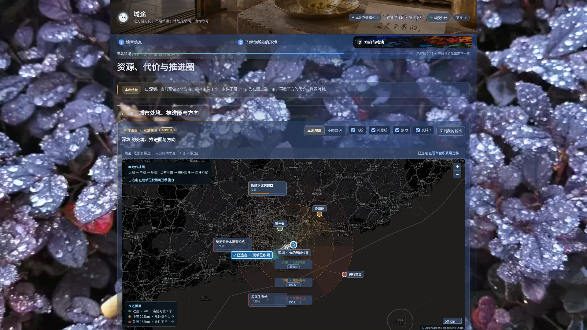

# 域途 · 使用说明书

> 版本：V1.0 ｜ 2026-11-27 ｜ 对应产品版本：V12.4
> 适用对象：第一次使用域途的人、赛事评审、演示与录屏者
> 一句话：把此刻的处境、可选的下一步、要付的代价显影出来；不替你做决定。

---

## 0. 一页速览

### 0.1 我想做什么，去哪里

| 我想做的事 | 去哪里 | 关键动作 |
|---|---|---|
| 第一次进入，先把自己的情况写清楚 | 第 1 步「填写信息」 | 选城市、年龄、身份，写一个方向 |
| 看看目标城市与真实讨论 | 第 2 步「了解你所处的环境」 | 点地图城市，切换「城市 / 讨论」 |
| 找当前阶段有哪些方向、哪些现在能做 | 第 3 步「方向清单」 | 看可行性标签，加入候选，二阶深挖 |
| 看一条方向要消耗什么、卡在哪 | 第 3 步「资源作战图」 | 点方向节点，读代价与张力 |
| 生成一份可保存的摘要 | 第 3 步「归属与摘要」 | 复制 Markdown，或下载 .md / .json |
| 领任务、做体验、复盘归档 | 第 4 步「成长闭环」 | 工作台 → 停靠驿站 → 归档 |
| 试一条 18 个月的人生路线 | 「更多 → 沙盘推演」 | 6 格各落一子，再采纳为计划 |
| 备份自己的数据 | 第 4 步「同伴经验域 → 数据」 | 下载完整备份 JSON |
| 看接口是否连通、是否离线 | 顶部数据状态胶囊 | 点开看逐项探测与「重新同步」 |
| 重看开篇、进入路演模式 | 顶部「更多」 | 「重看开篇」「路演模式」 |

### 0.2 五分钟最短路径

1. 打开链接，开篇可点「跳过」，也可等它自然结束。
2. 第 1 步：选城市与年龄，写一个方向（例如「土木工程」「电商运营」），点「进入第二步：了解你所处的环境」。
3. 第 2 步：点地图上的城市，看右侧「城市」与「讨论」两页。
4. 第 3 步：在方向清单里挑一条「当前可做」的方向，点「加入候选」或「选它 · 二阶深挖」；想看代价就点「看代价」。
5. 第 4 步：点「领取参考任务」或「＋ 新增自定义任务」；做完后「标记完成」；到「停靠驿站」回答三问、选下一步、归档。
6. 想试长期路线：顶部「更多 → 沙盘推演」，走至少两格后「采纳为计划」。

> 全程不需要注册、不需要登录。个人数据默认按浏览器隔离；平台页面内会自动接入数据表，离线时自动退回本机存储。

---

## 1. 它是什么，不是什么

### 1.1 适合的使用场景

- 高考 / 考研后的择校与专业方向对照；
- 毕业 1–3 年的转行、换岗、考证决策；
- 跨城市迁徙、回老家还是留在大城市；
- 已经工作一段时间，需要做一次阶段性复盘；
- 对「我现在的条件能走哪几步」缺少整体视图。

### 1.2 它明确不做的事

| 它不做 | 原因 |
|---|---|
| 不输出「推荐 / 建议 / 最适合你」 | 选择权属于你；系统只呈现条件、差异与代价 |
| 不预测成功率，不判断某条路值不值得 | 没有人能替另一个人预判结果 |
| 不设排行榜、不打卡、不写逾期红字 | 不制造焦虑；暂停、修改、放弃都是合法选择 |
| 不把近似数据包装成精确结论 | 城市属性、相似度、资源存量均有明确的数据标注与边界说明 |
| 不替你修改处境 | 只有你明确选择「有一点变化」时，归档才会让向量小幅漂移 |
| 不保存你的账号或密码 | 没有账号体系；本机标识不含任何账号信息 |

### 1.3 使用前请接受三个前提

1. **它显示的是「显影」，不是「答案」。** 同一份数据，你可以读出不同结论。
2. **计划是草稿。** 方向、任务、沙盘路线都可以改、可以停、可以放弃。
3. **结果不是评判。** 归档的是「这一轮走完了」，不是「你成功了或失败了」。

---

## 2. 开始使用

### 2.1 打开方式

- **平台在线版**：使用赛事提交页提供的 `prod` 地址（发布后由平台生成）。
- **公网兜底版**：<https://74iobb.github.io/yutu/>（纯前端；同源后端不存在，跨用户内容会自动降级为本机或空）。
- **本地开发版**：由项目维护者在本地启动，普通使用者无需关心。

建议使用近两年的 Chrome、Edge、Safari 或 Firefox。桌面端适合完整演示；手机端布局会自动收拢，触屏支持左右滑动切换步骤。

### 2.2 开篇序列

每次页面加载后的第一次进入，会播放约 8–9 秒的开篇：水束落下 → 涟漪铺开 → Voronoi 板块回正 → 「泻水置平地，各自东西南北流」逐字浮现 → 退潮显影。

- **跳过**：点击画面、按任意键，或点右下角「跳过 ›」。
- **声音**：右下角「声音 开 / 关」控制朗诵与环境低频；默认开。浏览器的自动播放策略可能拦截声音，点一下画面或声音按钮即可解锁。
- **重看**：顶部「更多 → 重看开篇」。
- **路演模式**：顶部「更多 → 路演模式」，强制有声，适合录屏与现场演示。
- **URL 开关**：`?overture=1` 每次刷新都播开篇；`?demo=1` 进入路演模式。
- **不会重复打扰**：在同一次页面会话内，从沙盘返回首页不会重播；刷新页面会重新播放。

### 2.3 界面地图

| 区域 | 作用 |
|---|---|
| 左上角品牌与刘看山 | 点一下打开陪伴角色「刘看山」的陪谈面板 |
| 顶部数据状态胶囊 | 显示「平台数据表 x/x」或「本地存储模式」，点开可看逐项探测、重新同步 |
| 「闭环 第 N 轮」胶囊 | 有任务或档案后出现，点一下回到第 4 步 |
| 「动效 开 / 关」 | 一键关闭全部过渡与动画，适合低性能设备或需要安静阅读时 |
| 「更多」 | 数据来源与口径、知乎快照时间、沙盘推演、重看开篇、路演模式 |
| 两大板块 | 「我的处境」（第 1–3 步）与「我的成长」（第 4 步，需先解锁） |
| 四步步骤条 | 填写信息 → 了解你所处的环境 → 方向与推演 → 成长闭环 |
| 步骤解锁进度 | 显示已解锁到第几步；可以跳到已解锁的任意步骤 |
| 进度概览条 | 阶段、城市、方向、归属域、阶段性胜利、方向候选、七维指纹 |

### 2.4 三个必须看懂的状态提示

1. **「示例值」标签**：第 1 步还没真正填写时，右侧判定结果只显示「尚未判定」，不会把默认模板当成你的数据。看到「示例值」说明当前仍是演示初始值。
2. **数据状态胶囊**：
   - 绿色「平台数据表 x/x」：读接口已连通；
   - 橙色「本地存储模式」：后端不可用，内容只保存在当前浏览器；
   - 点开面板可逐项查看接口状态，并可「重新同步」。
3. **写失败提示**：平台写入失败时，界面会先保留在本机，并提示稍后重试；不会因为网络问题丢掉你刚写的内容。

### 2.5 导航方式

- 点顶部四步步骤条，或点「我的处境 / 我的成长」两个板块；
- 桌面端按 `←` / `→` 切换已解锁步骤；
- 触屏左右滑动切换步骤；
- 第 3 步内部有三个视图：方向清单、资源作战图、归属与摘要；
- 第 4 步内部有四个页签：体验工作台、停靠驿站、胜利档案墙、同伴经验域。

> 未解锁的步骤会置灰。完成当前步的必要动作后，下一步才会出现。

---

## 3. 第 1 步：填写信息

**目标**：把「我是谁、我在哪、我现在的约束是什么」写成系统可读的处境。

页面顶部有「快速定位」：基本事实、结构化测量、校准量表、判定结果；点一下会平滑滚动到对应区块。

*图 1 · 第 1 步：左侧填写，右侧实时给出阶段与判定依据。*

### 3.1 基本信息（必填）

| 字段 | 选项 / 输入 | 填写建议 |
|---|---|---|
| 常住城市 | 省级行政区分组下的 46 个样本城市 | 选你实际长期生活与找工作的城市；后续地图、岗位密度、讨论都按它计算 |
| 年龄 | 16–45 岁 | 影响阶段判定与年龄维度 |
| 城乡属性 | 主城区 / 近郊新区 / 下辖县镇 | 会轻微调整地理维度 |
| 当前身份 | 在校/待业、已工作 | 决定下一步文案与任务类型 |
| 所学专业 / 方向 | 自由文本 | **必填**；写大类即可，例如「土木」「护理」「计算机」「电商运营」 |

**方向为什么必填**：第 3 步的检索、方向匹配与案例都依赖它。未命中内置大类时，系统会按关键词检索，并在界面标注「按关键词检索」，不会假装命中。

如果方向为空就点下一步，输入框会聚焦并抖动一下，提示「先写一个方向，哪怕只是一个大类」。

### 3.2 结构化测量（推荐）

点开「结构化测量」，会看到五组事实与行为问题，约 2 分钟：

1. **经济**：收入、支出、储备与还债；
2. **家庭**：赡养、照护与是否主要经济支柱；
3. **行业**：招聘趋势与工作稳定性，本地岗位密度作为客观项参与计算；
4. **体验**：完整走通的体验学习循环次数、小型验证项目数；
5. **探索**：面对不确定时主动检索、访谈、试错的具体行为频率。

填写时右侧会实时预览；只有点「应用这组测量」后，分数才写入处境量表。界面会给出「填写质量」，但那只反映完整度与一致性，不是心理测量信度。

### 3.3 校准量表（可选）

「校准量表」允许你手动拖动五个维度：经济压力、家庭负担、行业周期、认知惯性、体验历史。年龄在基本信息里选择，地理位置由你选择的城市与城乡属性导出，二者都不在这里自评。

- 手动调整会覆盖本次结构化测量的结果；
- 仅建议在你掌握额外信息、或测量题不适用时使用；
- 右侧「判定结果」会实时变化。

### 3.4 判定结果

右侧卡片给出：

- **当前阶段**：在校探索期（16–23）、初入职场期（22–27）、转向抉择期（26–33）、稳态深耕期（32–45）；
- **判定依据**：年龄、身份与体验历史的启发式组合；
- **检索方向**：命中内置大类，或按关键词检索；
- **阶段任务**：该阶段最重要的任务，不是命令；
- **地理位置**：由城市与城乡属性导出的近似值。

> 阶段是启发式判定，不是身份证。它会随你填写的年龄、身份、体验历史变化；同一人在不同时间可能落在不同阶段。

### 3.5 进入下一步

方向已填写后，点「进入第二步：了解你所处的环境 →」。之后随时可以回来修改，已填内容不会丢。

---

## 4. 第 2 步：了解你所处的环境

**目标**：把你所在的城市、区域结构与真实讨论放在同一屏，先看清「地」，再谈「路」。

*图 2 · 地图、蓝圈区域与右侧的城市 / 讨论页签。*

### 4.1 地图

- **拖动 / 滚轮缩放**：自由查看；点击城市点可切换当前城市。
- **蓝圈**：以当前城市为中心约 2.5° 的示意影响范围，用来表达「区域内还有哪些可选城市」。
- **资料点与飞线**：开关控制是否显示检索到的资料点；飞线只表示资料归属与信息密度，不代表人流方向、成功率或优先级。
- **图例**：颜色对应城市层级或资料类型；具体说明在「地图说明与坐标精度」里。
- **坐标精度**：城市坐标是近似经纬度，山脉是主要山系脊线示意，不用于地理测量。

### 4.2 「城市」页签

给出当前城市的速览：

- 岗位密度（高 / 中 / 低）；
- 生活成本（高 / 中 / 低）；
- 区域均值；
- 你的地理维度分数；
- 这片区域的构成：覆盖哪些城市、区域均值、迁移成本提示；
- 蓝圈内的邻近城市列表（最多展开 6 个，其余只显示数量）。

### 4.3 「讨论」页签

- **这座城市的近期讨论**：来自知乎开放平台检索快照，保留原文链接；点标题可打开原文。
- **这片区域的检索情况**：当前城市及蓝圈内周边城市的检索结果，已排除上方条目，并按你填写的方向相关度排序。
- 如果某个方向没有直接命中，会明确写「未直接提到『你的方向』，可作本地背景」，不会拿通用内容冒充个体结论。
- 桌面端两个页签会自动轮播；鼠标移入、手动切换后会暂停，避免内容被切走。

### 4.4 数据口径

- 城市属性为 APPROX（近似值），用于相对比较，不适合当作精确统计；
- 知乎内容为 REAL 快照，不是运行时实时检索；页头会显示快照时间；
- 没有检索结果时显示空状态，不用固定样例填充。

---

## 5. 第 3 步：方向与推演

**目标**：把这一阶段的方向摊开，标出哪些现在能做、要补什么条件、会消耗什么，再决定先试哪一条。

第 3 步有三个视图，顶部常驻「我的候选」条：

- **方向清单**：浏览全部方向、可行性、候选与案例；
- **资源作战图**：看选定方向的代价、资源与张力；
- **归属与摘要**：收拢处境、方向、归属结论与一页纸摘要。

### 5.1 我的候选（最多 4 条）

- 在方向卡上点「＋ 加入候选」，候选会出现在顶部；
- 点候选标签会在作战图上定位并选中；
- 最多 4 条，超出会提示「候选最多 4 条，先移除一条再加」；
- 可以逐条移除，或「清空候选」；
- 切换阶段后，不属于当前阶段的候选会标为「不在本阶段」，仍保留但不可定位。

### 5.2 方向清单

*图 3 · 方向清单：可行性标签、候选与三条操作入口。*

- **本步结论**：这一阶段共有多少个方向，其中当前可做多少个、需补条件多少个。
- **你的想法（可选）**：写一句你真正在意的约束或目标，例如「想做数控编程，但担心学历不够；每周能投入 6 小时，希望半年内看到结果」。它会参与二阶检索，不写也能继续。
- **检索依据**：展示命中内置专业大类，或按关键词命中多少条，以及检索语料规模。
- **方向卡**：每条方向给出可行性三档：
  - **当前可做**：现有条件下可以开始；
  - **需补条件**：现金流、时间或技能缺口未满足；
  - **条件不足**：当前约束下代价明显偏高。
- 展开「前置条件与判定依据」可以看到具体原因。
- 三个操作：
  - **＋ 加入候选**：放进顶部候选条；
  - **选它 · 二阶深挖**：选中并打开二阶检索抽屉；
  - **看代价 →**：选中并跳到资源作战图。
- **只看当前可做的**：勾选后隐藏「需补条件 / 条件不足」；若全部被隐藏，会提示先从「需补条件」里挑成本最低的一条。
- **方向星图**：全屏查看方向与可行性层次，中心是你，三层环按可行性排列。

### 5.3 二阶深挖

点「选它 · 二阶深挖」会打开右侧抽屉：

- 针对当前选中的方向做更细的检索；
- 会把一阶已经展示过的链接去重；
- 结果保留原文链接与摘要，摘要不代表平台结论；
- 可随时关闭，不会丢失已选方向。

### 5.4 资源作战图

*图 4 · 本地圈层：近 / 中 / 外圈、方向节点、候选与资源仓。*

- **本地圈层 / 全国网络**：
  - 本地圈层：近圈 55km、中圈 105km、外圈 155km，对应「当前可做 → 需补条件 → 条件不足」；
  - 全国网络：用城市近似坐标展示你的城市与全国样本城市的连接，飞线宽度只反映岗位密度差，不代表成功率或优先级。
- **方向节点**：点任一节点，右侧显示这条方向的推进阻力、前置条件、判定依据、消耗的一次性资源、相关张力。
- **候选与已选定**：候选带金色虚线圈；已选定会放大并加光圈。
- **一次性资源存量**：例如「应届生身份」「统招专升本报考资格」「低成本试错窗口」。资源条按三档显示，避免把近似推导当成精确百分比；每项都给出有效期与规则。
- **方向代价表**：方向、可行性、前置条件、消耗资源、相关张力、在图上位置。
- **方向张力**：互斥、共用资源或条件关系；没有已检索到的硬性互斥时显示空状态。
- **图例读法**：补给线表示该方向消耗的资源；张力来自条件，不来自人。

> 这张图借用作战图的图层语言，但不设主攻目标、不给成功率、也不把任何人设为敌军。

### 5.5 归属与摘要

*图 5 · 归属域、稳定度、过渡带与一页纸摘要。*

- **四个指标**：系统归属域、接近度、稳定度、过渡带（邻近域数量）。
- **处境 S**：七维分数的条形展示，每维带权重说明。
- **迁移 T**：完成过一次归档后，显示处境迁移（起点 → 当前）。
- **为什么是这个归属**：只显示方向贡献最大的五项，并标注同向 / 反向；综合相似度还包含强度接近度与低信息收缩。
- **方向约束 C**：你选中的方向及其可行性原因。
- **相近经验 R**：有效标记达到阈值的公共复盘，按相似度排列。
- **模型边界**：明确写出「归属是相似度路由，不是分类标签」「ΔS 漂移、可行性阈值与相似度权重待真实样本/专家标注校准」。
- **一页纸摘要**：
  - 「复制 Markdown」：复制到剪贴板；
  - 「下载 .md」：保存为 `域途-一页纸.md`；
  - 「下载 .json」：保存为 `域途-我的数据.json`，含阶段、档案、归属域、候选与胜利次数。

> 摘要可以直接贴进笔记、作品说明或复盘文档；它不包含你的本机标识。

### 5.6 怎么读这一页

1. 先看「当前可做」有多少条——这是你现在就能动的范围；
2. 再看「需补条件」里哪一条的缺口最小；
3. 点开代价，确认要消耗的资源你是否愿意付；
4. 最后看张力和归属，判断几条路是否互相排斥；
5. 选不选、先走哪条，仍然由你决定。

---

## 6. 第 4 步：成长闭环

**目标**：把「选中的方向」变成一次真实体验，做完、复盘、归档，再决定下一轮。

*图 6 · 闭环总览：当前站、完整六步、螺旋与指标。*

### 6.1 闭环的六个站

| 顺序 | 站点 | 在哪里做 | 说明 |
|---|---|---|---|
| 1 | 领取任务 | 体验工作台 | 从当前域载入参考任务，或自己写一条 |
| 2 | 去体验 | 线下 | 把这条体验在真实生活里做一遍 |
| 3 | 标记完成 | 体验工作台 | 做完后标记「已完成」 |
| 4 | 停靠自省 | 停靠驿站 | 回答三个问题 |
| 5 | 归档 | 停靠驿站 | 归档为阶段性胜利；处境是否变化由你判断 |
| 6 | 回看落点 | 第 3 步 | 回到方向与推演，看归属有没有变化 |

当前步骤会展开操作入口；走完六步、归档之后，才会出现方向确认与下一轮。

### 6.2 闭环全貌与方向确认

- **螺旋图**：高亮当前站；可以「聚焦闭环图」铺满视口，`Esc` 退出。
- **指标**：本轮任务、进行中、待归档、已闭环。
- **附加信息**：校验池复盘数、方向候选数、上一次归档的选择。
- **闭环后的方向确认**：归档完成后会问「你要走的方向是否发生变化？」
  - 「方向没变」：沿用当前处境与归属，开启下一轮（若仍有剩余任务则继续本轮）；
  - 若上一次以「暂时休整」收尾，按钮会变为「保持休整」，等你准备好再开下一轮；
  - 「方向变了」：回到第 1 步重新填写；
  - 已归档的胜利与历史任务不会因此丢失。

### 6.3 ① 体验工作台

*图 7 · 工作台：本轮任务、领取参考任务、自定义与状态切换。*

- **本轮方向**：从当前归属的前 6 个域里选一个，作为领取参考任务的来源。
- **领取参考任务**：把该域的参考任务加入本轮清单；任务会带经验出处、前置条件、风险提示、完成标准。
- **＋ 新增自定义任务**：至少 4 个字；选六体分类（亲情体验、团队体验、非营利组织体验、营利组织体验、创新创业体验、全球事务体验）。自定义任务与系统草稿在系统里权重相同。
- **状态筛选**：全部、进行中、已完成、暂时搁置、选择放弃。
- **任务操作**：
  - 「标记完成」：完成后闭环会亮起「停靠驿站」；
  - 状态下拉：可随时在四态之间切换；
  - 「移除」：删掉不适用的任务；
  - 已完成的任务可「去归档」，也可在「更多」里「重新打开」。
- **历史归档**：已并入胜利档案的任务，折叠显示，可展开回看。

> **关于「选择放弃」**：它不是失败。首次把一条任务标为放弃时，系统会把这次尝试记进处境——体验历史 +2、认知惯性 −1，并明确提示。这是一次轻量的成长记录，不是惩罚。

### 6.4 ② 停靠驿站

*图 8 · 驿站三步：拷问 → 回答三问 → 归档。*

停靠分三步：

1. **拷问**：回到出发时的处境，看看经济压力、家庭负担、年龄是否变化；下方会给出灵魂卡与当前进度。
2. **回答三问**：
   - 这段体验带给我的真实感受是什么；
   - 出发时的处境参数现在变了没有；
   - 原来的远方愿景对我还重要吗。
   - 三问可以留空，但**无有效内容的记录不会进入校验池**。
3. **归档**：确认可归档条数、下一步选择、自省完成数，然后「归档并闭合第 N 轮」。

**下一步怎么走（四者权重相同，没有哪一个更高级）**：

| 选择 | 含义 |
|---|---|
| 维持方向 | 继续当前路线 |
| 修改计划 | 方向不变，换做法 |
| 暂时休整 | 不推送新任务；休息也是闭环的一部分 |
| 更换方向 | 排除也是胜利 |

**这一轮之后，我的处境有变化吗**：

- **没有变化**：只记录成长，向量不动；
- **有一点变化**：按所选方向小幅漂移（例如维持方向：体验历史 +4、认知惯性 +1；更换方向：体验历史 +5、认知惯性 +6、行业周期 +2）。所有更新都是小幅调整，不做跳变。

**经验卡**：比整条复盘更轻。写一句「这段体验里可被他人复用的经验」（约 10 个字以上），点「提交经验卡到校验池」。它不改变向量，也不要求先完成整段体验；写入前会脱敏。

> 归档只针对已标记完成的体验。本轮没做完的任务会留在工作台，进入下一轮；每三轮年龄会自动 +1，这是时间事实，与是否成长无关。

### 6.5 ③ 胜利档案墙

胜利档案墙有三个内部视图：

- **记忆**：按次列出每次阶段性胜利，包含选择、自省与向量快照；可任选两个时间点做「两点对比」，比较七维变化。
- **曲线**：以成长河或单维曲线查看七维随时间的变化。
- **档案**：按次浏览全部胜利卡片。

点「成长画廊」可全屏铺开对比、曲线与完整时间轴。

### 6.6 ④ 同伴经验域

同伴经验域分为三个视图：**共建 / 我的 / 数据**。顶部常驻「我的贡献」卡：已提交复盘、公共节点、累计有效标记、平均校验进度，以及你参与的讨论数与收到的回复数；它只做自己的进度显示，不排名。

#### 共建

- **同处境者的复盘**：公开复盘列表，可按「最新 / 热议」排序。热议度 = 有效标记 + 参与讨论人数，1 人 1 分；排序不改变公共节点判定。
- **标记为有效**：每条复盘下方可点「标记为有效」；同一用户对同一条只能标记一次。
- **经验星云**：全屏按阶段浏览公开复盘与有效标记。
- **讨论**：树状讨论，支持回复与删除自己的讨论；在线写入前脱敏，离线仅保存在本机。
- **素材**：只接受公开的图片 / 语音链接加一句说明；平台不存文件，也不保证链接长期有效。含个人信息的地址不要贴。
- **同阶段的人后来去哪了**：自填去向样本 + 真实归档去向的匿名计数；样本少于 5 条时只显示条数，不显示比例。

#### 我的

- **我的校验池**：把自己归档的胜利提交为复盘。三问中至少一条有效内容（不少于 8 个字符）才可提交；提交后初始仅本人可见。
- **满 3 个不同用户标记有效**后，复盘升级为公共节点，进入知识网络；自己的复盘不参与自己的归属计算，只对他人可见。
- 可查看自己每条复盘的有效标记进度、讨论数与参与人数。
- 收到回复、讨论热度等会显示在这里，但不排名。

#### 数据

- **本机标识**：可复制，用于确认「这台设备的数据身份」；不含账号或密码。
- **下载完整备份 JSON**：包含个人档案与起点快照、体验任务、阶段性胜利、自己提交的复盘、自己参与的讨论、素材链接、去向样本、有效标记记录与方向候选。
- **清空本机历史数据**：清空本机档案、任务、档案墙、沙盘与视图记忆，并生成新的本机标识。平台数据表里的旧记录不会被删除，但不会再加载到这台设备。
- 备份是「导出」用途；当前没有一键导入按钮，换设备需要重新填写或由维护者协助处理。

### 6.7 「重新填写」与「清空本机」的区别

| 操作 | 位置 | 影响 |
|---|---|---|
| 重新填写 | 第 4 步底部 | 回到第 1 步，重置本次浏览中的任务、档案与校验池视图；本机快照重置，本机标识保留；平台记录不删除 |
| 清空本机历史数据 | 同伴经验域 → 数据 | 清空本机全部历史并生成新的本机标识；平台旧记录不删除，但不会再加载到这台设备 |

---

## 7. 沙盘推演

**目标**：在不改动真实处境的前提下，把未来 18 个月摆上桌面，看看一条路线会把你带到哪。

*图 9 · 沙盘：6 格 × 第一季度，右侧落子，底部结果对照。*

### 7.1 进入

- 顶部「更多 → 沙盘推演」；
- 第 4 步「先在沙盘里试走一轮」；
- 直接访问 `#/sandbox`。

沙盘与主流程共用同一份数据：它读取你的处境、阶段与归属，但**不修改**真实处境与档案。

### 7.2 读沙盘

- **6 格 = 18 个月**，每格一个季度，每格落一个动作；
- **当前处境**四张卡：位置、阶段、当前归属、可动用资源（现金缓冲、精力余量）；
- **现金 / 精力**是余量，不是金额；不足时不能落子；
- **每格时间成本**：不论是否行动，经济压力 +1；
- **维持现状对照**：同样走 6 格，用来比较「什么都不做」会发生什么。

### 7.3 落子

预设动作有 6 个：

| 动作 | 说明 | 现金 / 精力 |
|---|---|---|
| 小步试水 | 用一次最小验证换真实反馈 | −6 / −8 |
| 集中深练 | 把一块能力练到能独立出活 | −12 / −14 |
| 向外拓展 | 换城或扩到更大的圈层 | −16 / −10 |
| 借力加速 | 用兼职、跳槽或预算换时间 | +9 / −16 |
| 停靠休整 | 恢复精力，把这一段写下来 | +6 / +16 |
| 收束定盘 | 停止摇摆，把方向拆成小目标 | −8 / −9 |

> 正数表示该动作会补充对应余量，负数表示消耗；具体以界面显示为准。

**自定义的路**：

- 点「系统没有提到的路」；
- 写至少 4 个字，例如「去大理做数字游民」；
- 选任务分类与投入强度（低 / 中 / 高）；
- 系统会按这段文字检索真实原文，并记录投入与证据；
- **不推断这一步的七维变化**，只显示时间成本带来的变化。

每一步都可以「撤回这一步」；顶部「重新摆放」可整体清空。

### 7.4 结果对照与采纳

- **三条泳道**：现在、这条路线、维持现状；
- **七维变化**：现在 → 推演结束；
- **结论卡**：说明这条路线走到哪、稳定度如何、与维持现状的差异；
- **采纳为计划**：至少走两格才可采纳；会按动作与自定义的路生成最多 4 条体验任务，写进第 4 步的体验工作台，**不修改你的处境与档案**。

### 7.5 沙盘的边界

- 规则版本 v1，无随机数，不含概率；
- 预设动作的七维效果是规则假设，不是样本均值或实验结果；
- 结果不构成预测，也不代表「应该走哪条」；
- 「维持现状」同样消耗时间与现金，用于对照，不是推荐。

---

## 8. 刘看山陪谈

点左上角品牌图标，会打开陪伴角色「刘看山」：

- 它只基于你当前填写的内容回应，不读取外部个人信息；
- 提供若干固定问题（例如「我可以停下来吗？」「方向太多，怎么选？」「系统会给我打分吗？」「我手上有哪些一次性资源？」）；
- 可以「换一段话」，切换提示语；
- 它不做评判，也不替你做决定。

---

## 9. 数据、隐私与离线

### 9.1 数据存在哪里

| 场景 | 存储位置 | 说明 |
|---|---|---|
| 在平台页面内使用 | 平台数据表 | 通过 `POST /api/page/w/{token}` 调用工作流；本机标识做用户隔离 |
| 平台不可用 / 公网兜底版 | 浏览器 `localStorage` | 主流程可完整走完；页面顶部显示「本地存储模式」 |
| 写入失败 | 先写本机 | 界面提示稍后重试；不会丢掉刚写的内容 |

- **无账号体系**：每个人由浏览器生成的 `ownerKey` 隔离；换设备、换浏览器不会自动合并数据。
- **无密钥**：前端不持有任何平台密钥；知乎快照是离线文件。
- **平台 vs 公网兜底版**：公网兜底版没有同源后端，跨用户的复盘、讨论、素材、去向样本会为空或只显示本机内容，这是设计内的降级，不是故障。

### 9.2 离线时会怎样

- 个人档案、任务、胜利档案、沙盘、开篇全部可用；
- 同伴经验域的公共复盘、讨论、素材只能看到本机已加载的内容；
- 顶部状态胶囊会变为「本地存储模式」，并给出说明；
- 平台恢复后可点「重新同步」。

### 9.3 脱敏

以下内容在写入平台前会做脱敏：

- 去向样本（金额、公司、联系方式）；
- 讨论与回复；
- 素材说明；
- 经验卡与复盘正文。

脱敏不能保证 100% 识别所有敏感信息，**请不要主动填写身份证号、银行卡号、精确住址、他人隐私**。

### 9.4 备份与迁移

- 第 4 步 → 同伴经验域 → 数据 → 「下载完整备份 JSON」；
- 备份文件包含个人档案、任务、胜利、复盘、讨论、素材链接、去向样本、有效标记与方向候选；
- 备份在浏览器本地生成，不上传；
- 当前版本没有一键导入；如需迁移，请联系维护者按 JSON 结构处理。

### 9.5 不活跃衰减

超过 30 天没有新的体验归档，进入闭环时会应用一次小幅衰减：体验历史回落、认知惯性向稳健一端漂移，最多累计 3 次；页面顶部会明确提示「已按 N 天未活跃小幅衰减」。这是对「长时间不行动」的温和显影，不是惩罚。

---

## 10. 键盘、手势与无障碍

| 操作 | 效果 |
|---|---|
| `←` / `→` | 切换已解锁步骤 |
| 触屏左右滑动 | 切换步骤；侧栏内部滑动只切换页签，不翻整页 |
| `Esc` | 退出聚焦模式、关闭抽屉或弹层 |
| Tab | 正常键盘导航；开篇播放时保留 Tab 给键盘用户 |
| 任意键（开篇中） | 跳过开篇；焦点在按钮上时不抢键 |
| 「动效 关」 | 关闭全部过渡与动画 |
| 系统「减弱动效」 | 自动减少动画与平滑滚动 |

- 所有主要区块都有标题与可访问名称；
- 图表与地图配有文字说明与数据来源标签；
- 关键空状态、错误提示与写失败提示均可被读屏读取。

---

## 11. 五分钟演示动线（评审 / 录屏）

| 时间 | 画面 | 操作 | 讲解要点 |
|---|---|---|---|
| 0:00–0:20 | 开篇 | 不操作，让它播完；或点「跳过」 | 「泻水置平地，各自东西南北流」；每个人被放到地上，会流向不同方向 |
| 0:20–1:10 | 第 1 步 | 选深圳 / 27 岁 / 已工作 / 土木工程；展开结构化测量并应用 | 系统不判断该不该转，只把处境写成七维 |
| 1:10–1:50 | 第 2 步 | 点地图，切「城市 / 讨论」 | 蓝圈是影响范围；讨论来自知乎真实快照 |
| 1:50–2:50 | 第 3 步 | 选一条「当前可做」，加入候选，二阶深挖；切作战图看代价 | 可行性三档、资源消耗、张力；不给成功率 |
| 2:50–3:50 | 第 4 步 | 领取任务 → 标记完成 → 驿站三问 → 选「维持方向」→ 归档 | 闭环不是打卡；成长不一定立刻改变处境 |
| 3:50–4:20 | 同伴经验域 | 提交复盘、标记有效、发一条讨论 | ≥3 个有效标记升级公共节点；自己的复盘不参与自己的归属 |
| 4:20–4:50 | 沙盘 | 走两格 → 采纳为计划 | 18 个月、无随机、不改真实处境 |
| 4:50–5:00 | 更多 | 打开「数据来源与口径」 | 五级来源标签与缺口登记，数据诚实 |

> 演示时统一说「它把……摆出来」「你可以看到」，避免说「系统建议你走这条路」。

---

## 12. 常见问题

**Q1：为什么一打开就显示「示例值」？**
A：那说明你还没真正填写第 1 步，系统把默认模板标出来，避免把演示数据当成你的结论。填写任意字段后，「示例值」会消失，右侧才开始判定。

**Q2：为什么点「进入第二步」没有反应？**
A：方向为空。至少写一个大类，例如「土木」「护理」「计算机」；输入框会聚焦并提示。

**Q3：阶段是怎么判定的？会不会不准？**
A：阶段由年龄、身份与体验历史做启发式判定，不是心理测评。它会随填写变化；同一人在不同时间可能落在不同阶段。它的用途是决定展示哪一批方向与任务，不是给你贴标签。

**Q4：为什么方向只有几条，或者没有「当前可做」？**
A：方向清单只展示当前阶段的方向；可行性由城市岗位密度、经济压力、家庭负担、年龄与体验历史共同推导。若「当前可做」为空，说明约束较紧，可以先从「需补条件」里挑成本最低的一条。

**Q5：为什么系统不告诉我该选哪条？**
A：这是产品原则。它只呈现条件、差异与代价；选择权属于你。你可以在候选里比较，在沙盘里试走，但系统不会输出「推荐」。

**Q6：我的数据存在哪？换设备会同步吗？**
A：平台页面内写入平台数据表；平台不可用时存在当前浏览器。没有账号体系，换设备或换浏览器不会自动合并。可在「同伴经验域 → 数据」下载备份。

**Q7：为什么同伴经验域是空的？**
A：两种可能：一是你用的是公网兜底版或后端不可用，跨用户内容会降级为空；二是平台上还没有其他用户提交复盘。先完成一次归档并提交复盘，你自己的内容会出现在「我的」。

**Q8：我提交的复盘为什么别人看不到？**
A：提交后初始在「校验池」，只有本人可见；满 3 个不同用户标记有效后才升级为公共节点。没有有效内容的记录不会进入校验池。

**Q9：我给复盘点了「标记为有效」，为什么按钮变灰了？**
A：同一条复盘每个用户只能标记一次；已标记会显示「已标记」。离线时标记只保存在本机。

**Q10：归档之后还能改吗？**
A：归档记录本身不提供编辑；你可以在下一轮重新填写、调整方向与任务。已归档的胜利与历史任务不会因为重新填写而丢失。

**Q11：为什么我选的「放弃」改变了处境？**
A：首次把任务标为放弃，系统会把这次尝试记进处境（体验历史 +2、认知惯性 −1），并明确提示。它不是惩罚，而是承认「这条路你至少试过了」。重复标记不会重复扣减。

**Q12：为什么过一段时间回来，分数变了？**
A：超过 30 天没有新的归档，会应用一次小幅不活跃衰减（最多 3 次），页面顶部会提示原因。

**Q13：我想重新开始，会删掉平台数据吗？**
A：「重新填写」只重置本机当前视图与快照，平台记录不删除；「清空本机历史数据」会清空本机并生成新的本机标识，平台旧记录仍保留但不会再加载到这台设备。

**Q14：沙盘会改我的真实处境吗？**
A：不会。沙盘只读取处境做推演；「采纳为计划」只生成体验任务，不修改处境与档案。

**Q15：一页纸摘要包含隐私吗？**
A：摘要包含阶段、处境、归属域、候选与胜利次数，不包含本机标识、账号或联系方式。分享前仍建议自己通读一遍。

---

## 13. 术语表

| 术语 | 含义 |
|---|---|
| 阶段 | 在校探索期、初入职场期、转向抉择期、稳态深耕期；由年龄、身份与体验历史启发式判定 |
| 七维 | 地理位置、经济压力、家庭负担、年龄、行业周期、认知惯性、体验历史 |
| 归属域 | 七维相似度路由出的当前域，不是分类标签，也不是命运 |
| 接近度 | 与归属域的相似程度，用区间表达，不是精确概率 |
| 稳定度 | 与第二名的差距；分为几档，用于说明归属是否清晰 |
| 过渡带 | 与第一名接近的邻近域集合 |
| 候选 | 你暂时放入对比条的方向，最多 4 条 |
| 可行性三档 | 当前可做 / 需补条件 / 条件不足 |
| 一次性资源 | 用掉或过期不可逆的资源，如应届生身份、统招专升本报考资格、低成本试错窗口 |
| 阶段性胜利 | 在当前处境下完整走通一轮体验学习循环：完成体验、做出反思、形成对下一步有效的判断 |
| 校验池 | 你提交但尚未达到公共节点阈值的复盘集合 |
| 公共节点 | 满 3 个不同用户标记有效的复盘，进入知识网络供他人参考 |
| 有效标记 | 同处境用户对复盘点「标记为有效」，每人每条一次 |
| 经验卡 | 比完整复盘更轻的一句经验，同样进入校验池 |
| SET | 处境 S → 试验 → 迁移 T 的读法；第 3 步摘要按此组织 |
| 降级 | 后端不可用时自动退回本机存储；主流程仍可走完 |

---

## 14. 版本与反馈

- **说明书版本**：V1.0（2026-11-27）
- **对应产品版本**：V12.4
- **产品哲学**：[`docs/PHILOSOPHY.md`](PHILOSOPHY.md)
- **产品说明计划书**：[`docs/域途-产品说明计划书.md`](域途-产品说明计划书.md)
- **数据来源与口径**：[`docs/DATA-SOURCES.md`](DATA-SOURCES.md)
- **素材授权**：[`docs/ASSET-LICENSES.md`](ASSET-LICENSES.md)
- **表结构与端点**：[`.project.md`](../.project.md)

> 本说明书描述的是当前版本的实际行为。若界面与本文不一致，以产品内提示与最新代码为准；涉及数据口径的争议，以 `.project.md` 与 `docs/DATA-SOURCES.md` 为准。

---

*域途 · 远方是方向，不是终点；计划是草稿，由你改写。*
